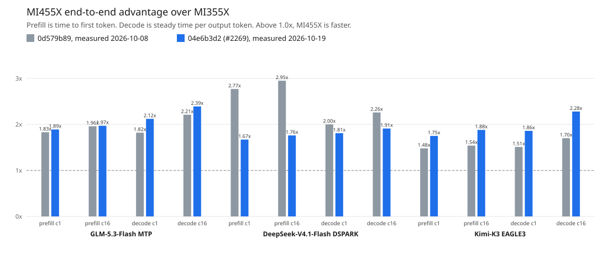

# Emulated rank 0 with speculative decoding: MI355X vs MI455X at `04e6b3d2`

One GPU per architecture serves global rank 0 of each model's CI layout
with `tokenspeed serve --emulate-rank-zero`, dummy weights, uniform MoE
routing and a fixed simulated accept length. Collectives are local
substitutes, so the numbers are a compute estimate, not serving
performance. Both architectures ran the same tree and workload.

The tree is the head of
[lightseekorg/tokenspeed#2269](https://github.com/lightseekorg/tokenspeed/pull/2269),
`04e6b3d2`, on main `9f182dbc`. Every server ran with
`--retraction-snapshot-host-gb 16`: this tree sizes the default retraction
snapshot pool from the device KV cache and checks it against the node's free
Host memory divided by the emulated rank count, which rejects GLM-5.3-Flash
on one GPU. No benchmark request retracts. MI355X ran Kimi-K3 on a second GPU
of the same host while DeepSeek-V4.1-Flash finished.



The bars are end-to-end MI355X time divided by MI455X time. Above 1.0x,
MI455X is faster. Gray is the 2026-10-08 comparison at `0d579b89`. Blue is
this run. Prefill is time to first token. Decode is steady time per output
token. The model labels include the speculative method: MTP, DSPARK, and
EAGLE3.

Kernel categories were revised on 2026-10-20 from the same profiles:
sparse attention now splits into index scoring, index top-k and the
attention over the selected rows, and kernels that had fallen into other
now count as MoE, dense GEMM or quantize.

## Provenance

| Field | Value |
|---|---|
| TokenSpeed revision | `04e6b3d20538e210bb96f179f4882dc78c5f5063` |
| Commit date (UTC) | 2026-10-19 |
| Changes on top | 0 files, identical on both hosts |
| Measured | 2026-10-19 |
| Prompt / output tokens | 50,000 / 500 |
| Concurrencies | 1, 16 |
| Warmup / measured waves | 1 / 1 |
| MI355X | `gfx950:sramecc+:xnack-`, 2.14.0+rocm7.2, `zhewenyu/emulate-rank0:d473d3f7-gfx950` |
| MI455X | `gfx1250`, 2.14.0+rocm10.2.0a20260923, `tokenspeed-gfx1250:9b707d56-torch214-tt3910-sched0138` |
| tokenspeed-triton | 3.9.10.post20261008 / 3.9.10.post20261008 |

## Simulated acceptance

Logged values are medians over the server's 40-step decode windows;
windows that straddle a prefill keep fewer tokens. See
`emulate_rank0/README.md` for where each simulated value comes from.

| Model | Layout emulated | Simulated | MI355X logged | MI455X logged |
|---|---|---:|---|---|
| GLM-5.3-Flash MTP | TP4 | 2.9 | 2.90 (18 windows) | 2.90 (18 windows) |
| DeepSeek-V4.1-Flash DSPARK | TP4 | 3.9 | 3.90 (13 windows) | 3.90 (13 windows) |
| Kimi-K3 EAGLE3 | TP8 | 3.75 | 3.75 (14 windows) | 3.75 (14 windows) |

Latency rows are lower-is-better and throughput rows higher-is-better;
the last column is always MI455X's advantage. TPOT p50 is per request
over its whole decode, as CI reports it. At batch 16 every request
arrives at once, so a request whose prompt finishes early decodes
between other requests' prefill chunks, and its TPOT mostly measures
prefill. Steady decode TPOT is the median over the server's 40-step
decode windows in which every request was decoding and no prefill ran;
decode tok/s per user and the decode columns below use it. Both include
the speculative speedup.

## GLM-5.3-Flash MTP

| Metric | Batch | MI355X (gfx950) | MI455X (gfx1250) | MI455X advantage |
|---|---:|---:|---:|---:|
| TTFT p50 (ms) | 1 | 2,067.6 | 1,096.3 | 1.89x |
| TPOT p50 (ms) | 1 | 4.8 | 2.3 | 2.09x |
| steady decode TPOT (ms) | 1 | 4.7 | 2.2 | 2.12x |
| decode tok/s per user | 1 | 211.8 | 449.5 | 2.12x |
| aggregate output tok/s | 1 | 112.2 | 223.3 | 1.99x |
| TTFT p50 (ms) | 16 | 16,931.5 | 8,583.3 | 1.97x |
| TPOT p50 (ms) | 16 | 39.6 | 19.5 | 2.03x |
| steady decode TPOT (ms) | 16 | 9.5 | 4.0 | 2.39x |
| decode tok/s per user | 16 | 105.2 | 251.0 | 2.39x |
| aggregate output tok/s | 16 | 217.8 | 436.5 | 2.00x |

Accumulated GPU kernel time per bucket, MI355X over MI455X, so
above 1.00x means MI455X is ahead. The last row compares the
measured TTFT p50 and steady decode TPOT from the table above; it
is not a total of the rows.

| Category | prefill c1 | prefill c16 | decode c1 | decode c16 |
|---|---:|---:|---:|---:|
| KDA state scan | 1.51x | 1.54x | — | — |
| KDA other | 1.98x | 2.00x | 1.18x | 1.57x |
| MoE | 2.08x | 2.04x | 1.98x | 3.05x |
| index top-k | 0.76x | 0.76x | 0.81x | 0.79x |
| index scoring | 0.96x | 0.92x | 1.74x | 3.05x |
| sparse attention | 5.27x | 5.26x | 7.71x | 1.50x |
| dense GEMM | 2.37x | 2.40x | 2.28x | 2.02x |
| attention | 1.19x | 1.21x | 1.06x | 1.18x |
| hyper-connections | 2.83x | 2.83x | 1.66x | 1.48x |
| quantize | 1.47x | 1.51x | 1.30x | 1.59x |
| rmsnorm | 1.76x | 1.78x | 1.13x | 1.16x |
| top-k and sort | 1.13x | 1.26x | — | — |
| sampling | 1.86x | 2.12x | 1.38x | 1.53x |
| elementwise | 1.37x | 1.39x | 1.24x | 1.37x |
| other | 5.30x | 5.42x | 1.14x | 3.76x |
| all kernels | 2.12x | 2.11x | 1.89x | 2.21x |
| **End-to-end** | **1.89x** (TTFT) | **1.97x** (TTFT) | **2.12x** (steady TPOT) | **2.39x** (steady TPOT) |

<details><summary>MI355X (gfx950) prefill c1: heaviest 10 kernels</summary>

| Rank | Category | Kernel | GPU time (ms) | Calls | Mean/call (us) | Share |
|---:|---|---|---:|---:|---:|---:|
| 1 | dense GEMM | `_w8a8_block_fp8_matmul` | 337.727 | 906 | 372.8 | 17.10% |
| 2 | sparse attention | `_dsa_dense_mfma_kv_kernel` | 326.196 | 86 | 3,793.0 | 16.52% |
| 3 | MoE | `gluon_bf16_moe_stage1_kernel` | 322.353 | 294 | 1,096.4 | 16.32% |
| 4 | MoE | `gluon_bf16_moe_stage2_kernel` | 138.717 | 294 | 471.8 | 7.03% |
| 5 | hyper-connections | `gluon_mhc_prefill_project_gfx950` | 106.862 | 630 | 169.6 | 5.41% |
| 6 | index scoring | `gluon_kpool_prefill_topk_fp8_plan_gfx950` | 77.121 | 120 | 642.7 | 3.91% |
| 7 | dense GEMM | `Cijk_Alik_Bljk_BBS_BH_Bias_HA_S_SAV_UserArgs_MT208x256x64_MI16x16x1_SN_LDSB1_AFC0_AFEM1_AFEM1_ASEM1_CLR1_CADS0_DTLA0_...` | 70.597 | 204 | 346.1 | 3.58% |
| 8 | hyper-connections | `gluon_mhc_post_gfx950` | 63.851 | 630 | 101.4 | 3.23% |
| 9 | KDA state scan | `gluon_kda_paged_prefill_state_scan_gfx950` | 63.192 | 238 | 265.5 | 3.20% |
| 10 | index top-k | `_dsa_oneblock_manual_radix_topk_kernel` | 60.130 | 146 | 411.9 | 3.05% |

</details>

<details><summary>MI355X (gfx950) prefill c16: heaviest 10 kernels</summary>

| Rank | Category | Kernel | GPU time (ms) | Calls | Mean/call (us) | Share |
|---:|---|---|---:|---:|---:|---:|
| 1 | dense GEMM | `_w8a8_block_fp8_matmul` | 5,345.869 | 12,704 | 420.8 | 17.25% |
| 2 | sparse attention | `_dsa_dense_mfma_kv_kernel` | 5,190.004 | 1,208 | 4,296.4 | 16.74% |
| 3 | MoE | `gluon_bf16_moe_stage1_kernel` | 4,962.300 | 4,116 | 1,205.6 | 16.01% |
| 4 | MoE | `gluon_bf16_moe_stage2_kernel` | 2,148.641 | 4,116 | 522.0 | 6.93% |
| 5 | hyper-connections | `gluon_mhc_prefill_project_gfx950` | 1,670.580 | 8,820 | 189.4 | 5.39% |
| 6 | index scoring | `gluon_kpool_prefill_topk_fp8_plan_gfx950` | 1,196.290 | 1,764 | 678.2 | 3.86% |
| 7 | dense GEMM | `Cijk_Alik_Bljk_BBS_BH_Bias_HA_S_SAV_UserArgs_MT208x256x64_MI16x16x1_SN_LDSB1_AFC0_AFEM1_AFEM1_ASEM1_CLR1_CADS0_DTLA0_...` | 1,135.705 | 3,298 | 344.4 | 3.66% |
| 8 | hyper-connections | `gluon_mhc_post_gfx950` | 1,020.661 | 8,820 | 115.7 | 3.29% |
| 9 | index top-k | `_dsa_oneblock_manual_radix_topk_kernel` | 1,018.226 | 2,372 | 429.3 | 3.28% |
| 10 | KDA state scan | `gluon_kda_paged_prefill_state_scan_gfx950` | 998.863 | 3,332 | 299.8 | 3.22% |

</details>

<details><summary>MI355X (gfx950) decode c1: heaviest 10 kernels</summary>

| Rank | Category | Kernel | GPU time (ms) | Calls | Mean/call (us) | Share |
|---:|---|---|---:|---:|---:|---:|
| 1 | dense GEMM | `_w8a8_block_fp8_matmul` | 164.991 | 8,832 | 18.7 | 16.98% |
| 2 | sparse attention | `_dsa_dense_mfma_kv_kernel` | 120.831 | 896 | 134.9 | 12.43% |
| 3 | MoE | `_stage1_fp8_warp_gemv` | 88.764 | 2,880 | 30.8 | 9.13% |
| 4 | hyper-connections | `gluon_mhc_pre_gfx950` | 58.233 | 5,760 | 10.1 | 5.99% |
| 5 | MoE | `_stage2_fp8_warp_gemv` | 56.924 | 2,880 | 19.8 | 5.86% |
| 6 | hyper-connections | `_mhc_prenorm_gemm_triton_kernel` | 55.600 | 5,760 | 9.7 | 5.72% |
| 7 | dense GEMM | `Cijk_Alik_Bljk_BBS_BH_Bias_HA_S_SAV_UserArgs_MT256x16x64_MI16x16x1_SN_LDSB1_AFC0_AFEM1_AFEM1_ASEM1_CLR1_CADS0_DTLA0_D...` | 32.401 | 2,368 | 13.7 | 3.33% |
| 8 | index top-k | `_dsa_oneblock_manual_radix_topk_kernel` | 29.469 | 896 | 32.9 | 3.03% |
| 9 | quantize | `_fp8_token_group_quantize_kernel` | 26.136 | 8,832 | 3.0 | 2.69% |
| 10 | KDA other | `fused_recurrent_kda_mtp_fwd_kernel` | 23.664 | 2,176 | 10.9 | 2.43% |

</details>

<details><summary>MI355X (gfx950) decode c16: heaviest 10 kernels</summary>

| Rank | Category | Kernel | GPU time (ms) | Calls | Mean/call (us) | Share |
|---:|---|---|---:|---:|---:|---:|
| 1 | MoE | `gluon_bf16_moe_stage1_kernel` | 618.361 | 2,688 | 230.0 | 33.65% |
| 2 | MoE | `gluon_bf16_moe_stage2_kernel` | 250.544 | 2,688 | 93.2 | 13.64% |
| 3 | dense GEMM | `_w8a8_block_fp8_matmul` | 157.751 | 8,832 | 17.9 | 8.59% |
| 4 | index scoring | `_kpool_score_dense_mma_kernel` | 77.665 | 896 | 86.7 | 4.23% |
| 5 | hyper-connections | `gluon_mhc_pre_gfx950` | 61.623 | 5,760 | 10.7 | 3.35% |
| 6 | KDA other | `fused_recurrent_kda_mtp_fwd_kernel` | 49.243 | 2,176 | 22.6 | 2.68% |
| 7 | dense GEMM | `Cijk_Alik_Bljk_BBS_BH_Bias_HA_S_SAV_UserArgs_MT64x32x256_MI16x16x1_SN_LDSB0_AFC0_AFEM1_AFEM1_ASEM1_CLR0_CADS0_DTLA1_D...` | 46.064 | 2,176 | 21.2 | 2.51% |
| 8 | hyper-connections | `_mhc_prenorm_gemm_triton_kernel` | 44.391 | 5,760 | 7.7 | 2.42% |
| 9 | dense GEMM | `Cijk_Alik_Bljk_BBS_BH_Bias_HA_S_SAV_UserArgs_MT16x16x1024_MI16x16x1_SN_LDSB1_AFC0_AFEM1_AFEM1_ASEM1_CLR1_CADS0_DTLA0_...` | 42.982 | 5,120 | 8.4 | 2.34% |
| 10 | sparse attention | `_dsa_dense_mfma_kv_kernel` | 38.556 | 896 | 43.0 | 2.10% |

</details>

<details><summary>MI455X (gfx1250) prefill c1: heaviest 10 kernels</summary>

| Rank | Category | Kernel | GPU time (ms) | Calls | Mean/call (us) | Share |
|---:|---|---|---:|---:|---:|---:|
| 1 | MoE | `_fp8_block_down_gfx1250` | 108.418 | 303 | 357.8 | 11.66% |
| 2 | MoE | `_fp8_block_gate_up_gfx1250` | 97.376 | 303 | 321.4 | 10.47% |
| 3 | dense GEMM | `_w8a8_block_fp8_matmul` | 88.623 | 875 | 101.3 | 9.53% |
| 4 | index top-k | `_dsa_wave32_radix_topk_kernel` | 86.564 | 146 | 592.9 | 9.31% |
| 5 | index scoring | `gluon_kpool_prefill_topk_fp8_plan_gfx1250` | 80.905 | 120 | 674.2 | 8.70% |
| 6 | sparse attention | `_dsa_selected_dense_wmma_kernel` | 61.607 | 86 | 716.4 | 6.62% |
| 7 | dense GEMM | `Cijk_Alik_Bljk_BBS_BH_Bias_HA_S_SAV_UserArgs_MT208x256x128_MI16x16x1_SN_LDSB0_AFC1_AG0_AGGSUA0_AGNTAB0_AFEM1_AFEM1_AS...` | 51.387 | 204 | 251.9 | 5.52% |
| 8 | KDA state scan | `gluon_kda_paged_prefill_state_scan_gfx1250` | 41.855 | 238 | 175.9 | 4.50% |
| 9 | hyper-connections | `_mhc_post_hc4_triton_kernel` | 30.740 | 630 | 48.8 | 3.30% |
| 10 | hyper-connections | `gluon_mhc_mixes_project_gfx1250` | 26.530 | 630 | 42.1 | 2.85% |

</details>

<details><summary>MI455X (gfx1250) prefill c16: heaviest 10 kernels</summary>

| Rank | Category | Kernel | GPU time (ms) | Calls | Mean/call (us) | Share |
|---:|---|---|---:|---:|---:|---:|
| 1 | MoE | `_fp8_block_down_gfx1250` | 1,718.688 | 4,246 | 404.8 | 11.73% |
| 2 | MoE | `_fp8_block_gate_up_gfx1250` | 1,524.703 | 4,246 | 359.1 | 10.40% |
| 3 | index top-k | `_dsa_wave32_radix_topk_kernel` | 1,435.272 | 2,372 | 605.1 | 9.79% |
| 4 | dense GEMM | `_w8a8_block_fp8_matmul` | 1,398.271 | 12,250 | 114.1 | 9.54% |
| 5 | index scoring | `gluon_kpool_prefill_topk_fp8_plan_gfx1250` | 1,304.707 | 1,764 | 739.6 | 8.90% |
| 6 | sparse attention | `_dsa_selected_dense_wmma_kernel` | 982.962 | 1,208 | 813.7 | 6.71% |
| 7 | dense GEMM | `Cijk_Alik_Bljk_BBS_BH_Bias_HA_S_SAV_UserArgs_MT208x256x128_MI16x16x1_SN_LDSB0_AFC1_AG0_AGGSUA0_AGNTAB0_AFEM1_AFEM1_AS...` | 831.537 | 3,298 | 252.1 | 5.67% |
| 8 | KDA state scan | `gluon_kda_paged_prefill_state_scan_gfx1250` | 648.681 | 3,332 | 194.7 | 4.43% |
| 9 | hyper-connections | `_mhc_post_hc4_triton_kernel` | 489.313 | 8,820 | 55.5 | 3.34% |
| 10 | hyper-connections | `gluon_mhc_mixes_project_gfx1250` | 419.291 | 8,820 | 47.5 | 2.86% |

</details>

<details><summary>MI455X (gfx1250) decode c1: heaviest 10 kernels</summary>

| Rank | Category | Kernel | GPU time (ms) | Calls | Mean/call (us) | Share |
|---:|---|---|---:|---:|---:|---:|
| 1 | dense GEMM | `_wmma_tdm_dense_kernel` | 38.875 | 9,408 | 4.1 | 7.55% |
| 2 | index top-k | `_dsa_wave32_radix_topk_kernel` | 37.688 | 896 | 42.1 | 7.32% |
| 3 | MoE | `_fp8_block_gate_up_gfx1250` | 33.296 | 2,880 | 11.6 | 6.47% |
| 4 | dense GEMM | `Cijk_Alik_Bljk_BBS_BH_Bias_HA_S_SAV_UserArgs_MT64x16x64_MI16x16x1_SN_LDSB0_AFC1_AG0_AGGSUA0_AGNTAB0_AFEM1_AFEM1_ASEM1...` | 33.038 | 5,376 | 6.1 | 6.42% |
| 5 | hyper-connections | `gluon_mhc_mixes_reduce_gfx1250` | 27.254 | 5,760 | 4.7 | 5.29% |
| 6 | dense GEMM | `gluon_mm_fp8_blockscale_gfx1250_bn16_bk2048_buf3_sk1_tdmf0` | 25.142 | 4,864 | 5.2 | 4.88% |
| 7 | hyper-connections | `gluon_mhc_mixes_project_gfx1250` | 23.423 | 5,760 | 4.1 | 4.55% |
| 8 | MoE | `_fp8_block_down_gfx1250` | 20.742 | 2,880 | 7.2 | 4.03% |
| 9 | rmsnorm | `_rmsnorm_kernel` | 20.241 | 6,784 | 3.0 | 3.93% |
| 10 | quantize | `_fp8_token_group_quantize_kernel` | 20.116 | 8,832 | 2.3 | 3.91% |

</details>

<details><summary>MI455X (gfx1250) decode c16: heaviest 10 kernels</summary>

| Rank | Category | Kernel | GPU time (ms) | Calls | Mean/call (us) | Share |
|---:|---|---|---:|---:|---:|---:|
| 1 | MoE | `_fp8_block_gate_up_gfx1250` | 174.744 | 2,880 | 60.7 | 21.01% |
| 2 | MoE | `_fp8_block_down_gfx1250` | 100.601 | 2,880 | 34.9 | 12.09% |
| 3 | dense GEMM | `_wmma_tdm_dense_kernel` | 64.985 | 10,112 | 6.4 | 7.81% |
| 4 | index top-k | `_dsa_wave32_radix_topk_kernel` | 40.375 | 896 | 45.1 | 4.85% |
| 5 | dense GEMM | `Cijk_Alik_Bljk_BBS_BH_Bias_HA_S_SAV_UserArgs_MT32x32x64_MI16x16x1_SN_LDSB0_AFC1_AG0_AGGSUA0_AGNTAB0_AFEM1_AFEM1_ASEM1...` | 32.348 | 5,120 | 6.3 | 3.89% |
| 6 | hyper-connections | `gluon_mhc_mixes_reduce_gfx1250` | 28.013 | 5,760 | 4.9 | 3.37% |
| 7 | hyper-connections | `gluon_mhc_mixes_project_gfx1250` | 27.099 | 5,760 | 4.7 | 3.26% |
| 8 | KDA other | `fused_recurrent_kda_mtp_fwd_kernel` | 26.479 | 2,176 | 12.2 | 3.18% |
| 9 | sparse attention | `_dsa_selected_dense_wmma_kernel` | 23.731 | 896 | 26.5 | 2.85% |
| 10 | index scoring | `_kpool_score_dense_mma_kernel` | 23.653 | 896 | 26.4 | 2.84% |

</details>

## DeepSeek-V4.1-Flash DSPARK

| Metric | Batch | MI355X (gfx950) | MI455X (gfx1250) | MI455X advantage |
|---|---:|---:|---:|---:|
| TTFT p50 (ms) | 1 | 805.2 | 481.9 | 1.67x |
| TPOT p50 (ms) | 1 | 3.3 | 1.8 | 1.80x |
| steady decode TPOT (ms) | 1 | 3.2 | 1.8 | 1.81x |
| decode tok/s per user | 1 | 307.8 | 557.2 | 1.81x |
| aggregate output tok/s | 1 | 203.3 | 357.4 | 1.76x |
| TTFT p50 (ms) | 16 | 6,655.2 | 3,783.5 | 1.76x |
| TPOT p50 (ms) | 16 | 19.0 | 10.6 | 1.79x |
| steady decode TPOT (ms) | 16 | 6.9 | 3.6 | 1.91x |
| decode tok/s per user | 16 | 144.4 | 275.8 | 1.91x |
| aggregate output tok/s | 16 | 494.6 | 878.7 | 1.78x |

Accumulated GPU kernel time per bucket, MI355X over MI455X, so
above 1.00x means MI455X is ahead. The last row compares the
measured TTFT p50 and steady decode TPOT from the table above; it
is not a total of the rows.

| Category | prefill c1 | prefill c16 | decode c1 | decode c16 |
|---|---:|---:|---:|---:|
| MoE | 2.56x | 2.58x | 2.51x | 2.49x |
| index top-k | 0.48x | 0.48x | 0.48x | 0.48x |
| index scoring | 6.51x | 6.56x | 3.02x | 5.60x |
| sparse attention | 1.10x | 1.10x | 1.44x | 1.15x |
| dense GEMM | 1.29x | 1.27x | 1.50x | 1.36x |
| hyper-connections | 1.76x | 1.77x | 1.19x | 1.33x |
| quantize | 0.68x | 0.69x | 1.05x | 0.48x |
| rmsnorm | 1.84x | 1.91x | 1.14x | 1.31x |
| top-k and sort | 1.23x | 1.22x | — | — |
| sampling | 1.42x | 1.77x | 1.40x | 1.41x |
| elementwise | 1.35x | 1.36x | 1.31x | 1.40x |
| other | 1.73x | 1.73x | 1.31x | 1.35x |
| all kernels | 1.95x | 1.95x | 1.37x | 1.68x |
| **End-to-end** | **1.67x** (TTFT) | **1.76x** (TTFT) | **1.81x** (steady TPOT) | **1.91x** (steady TPOT) |

<details><summary>MI355X (gfx950) prefill c1: heaviest 10 kernels</summary>

| Rank | Category | Kernel | GPU time (ms) | Calls | Mean/call (us) | Share |
|---:|---|---|---:|---:|---:|---:|
| 1 | index scoring | `gluon_dsv41_index_topk_gfx950` | 282.604 | 593 | 476.6 | 36.11% |
| 2 | MoE | `gluon_mxfp4_moe_stage1_kernel` | 74.332 | 160 | 464.6 | 9.50% |
| 3 | dense GEMM | `gluon_mm_mxfp8_gfx950` | 69.289 | 737 | 94.0 | 8.85% |
| 4 | MoE | `gluon_mxfp4_moe_stage2_1x2_kernel` | 60.755 | 160 | 379.7 | 7.76% |
| 5 | sparse attention | `gluon_dsv4_prefill_gfx950` | 55.188 | 160 | 344.9 | 7.05% |
| 6 | index top-k | `gluon_dsv41_index_topk_select_gfx950` | 30.485 | 593 | 51.4 | 3.90% |
| 7 | hyper-connections | `gluon_mhc_post_gfx950` | 30.406 | 320 | 95.0 | 3.89% |
| 8 | hyper-connections | `gluon_mhc_mixes_project_gfx950` | 21.445 | 320 | 67.0 | 2.74% |
| 9 | elementwise | `_rope_inplace_kernel` | 19.208 | 402 | 47.8 | 2.45% |
| 10 | hyper-connections | `gluon_mhc_apply_pre_gfx950` | 18.698 | 327 | 57.2 | 2.39% |

</details>

<details><summary>MI355X (gfx950) prefill c16: heaviest 10 kernels</summary>

| Rank | Category | Kernel | GPU time (ms) | Calls | Mean/call (us) | Share |
|---:|---|---|---:|---:|---:|---:|
| 1 | index scoring | `gluon_dsv41_index_topk_gfx950` | 4,527.069 | 9,566 | 473.2 | 36.56% |
| 2 | MoE | `gluon_mxfp4_moe_stage1_kernel` | 1,134.283 | 2,280 | 497.5 | 9.16% |
| 3 | dense GEMM | `gluon_mm_mxfp8_gfx950` | 1,073.421 | 10,322 | 104.0 | 8.67% |
| 4 | MoE | `gluon_mxfp4_moe_stage2_1x2_kernel` | 946.175 | 2,280 | 415.0 | 7.64% |
| 5 | sparse attention | `gluon_dsv4_prefill_gfx950` | 892.206 | 2,880 | 309.8 | 7.21% |
| 6 | index top-k | `gluon_dsv41_index_topk_select_gfx950` | 490.528 | 9,566 | 51.3 | 3.96% |
| 7 | hyper-connections | `gluon_mhc_post_gfx950` | 485.353 | 4,560 | 106.4 | 3.92% |
| 8 | hyper-connections | `gluon_mhc_mixes_project_gfx950` | 341.009 | 4,560 | 74.8 | 2.75% |
| 9 | elementwise | `_rope_inplace_kernel` | 305.517 | 5,718 | 53.4 | 2.47% |
| 10 | hyper-connections | `gluon_mhc_apply_pre_gfx950` | 297.255 | 4,658 | 63.8 | 2.40% |

</details>

<details><summary>MI355X (gfx950) decode c1: heaviest 10 kernels</summary>

| Rank | Category | Kernel | GPU time (ms) | Calls | Mean/call (us) | Share |
|---:|---|---|---:|---:|---:|---:|
| 1 | MoE | `_pipelined_moe_kernel_scaled_block_schedule` | 182.266 | 5,504 | 33.1 | 23.94% |
| 2 | dense GEMM | `gluon_mm_mxfp8_decode_gfx950` | 119.246 | 14,528 | 8.2 | 15.66% |
| 3 | index top-k | `gluon_dsv41_index_topk_select_gfx950` | 46.528 | 512 | 90.9 | 6.11% |
| 4 | sparse attention | `gluon_dsv41_selected_attention_gfx950` | 45.128 | 2,560 | 17.6 | 5.93% |
| 5 | dense GEMM | `gluon_mm_a16w16_medium_gfx950` | 43.300 | 5,312 | 8.2 | 5.69% |
| 6 | hyper-connections | `gluon_mhc_mixes_reduce_gfx950` | 34.050 | 5,504 | 6.2 | 4.47% |
| 7 | hyper-connections | `gluon_mhc_mixes_project_gfx950` | 28.939 | 5,504 | 5.3 | 3.80% |
| 8 | hyper-connections | `gluon_mhc_apply_pre_gfx950` | 24.561 | 5,632 | 4.4 | 3.23% |
| 9 | index scoring | `gluon_dsv41_index_topk_gfx950` | 20.027 | 512 | 39.1 | 2.63% |
| 10 | sparse attention | `gluon_dsv41_selected_attention_reduce_gfx950` | 17.971 | 2,560 | 7.0 | 2.36% |

</details>

<details><summary>MI355X (gfx950) decode c16: heaviest 10 kernels</summary>

| Rank | Category | Kernel | GPU time (ms) | Calls | Mean/call (us) | Share |
|---:|---|---|---:|---:|---:|---:|
| 1 | MoE | `gluon_mxfp4_moe_stage1_kernel` | 451.326 | 2,752 | 164.0 | 25.70% |
| 2 | MoE | `gluon_mxfp4_moe_stage2_1x2_kernel` | 247.837 | 2,752 | 90.1 | 14.11% |
| 3 | dense GEMM | `gluon_mm_mxfp8_decode_gfx950` | 216.128 | 14,336 | 15.1 | 12.30% |
| 4 | index scoring | `gluon_dsv41_index_topk_gfx950` | 197.941 | 512 | 386.6 | 11.27% |
| 5 | sparse attention | `gluon_dsv41_selected_attention_gfx950` | 72.427 | 2,560 | 28.3 | 4.12% |
| 6 | index top-k | `gluon_dsv41_index_topk_select_gfx950` | 47.038 | 512 | 91.9 | 2.68% |
| 7 | dense GEMM | `gluon_mm_a16w16_medium_gfx950` | 38.433 | 2,752 | 14.0 | 2.19% |
| 8 | hyper-connections | `gluon_mhc_mixes_project_gfx950` | 36.436 | 5,504 | 6.6 | 2.07% |
| 9 | hyper-connections | `gluon_mhc_mixes_reduce_gfx950` | 33.991 | 5,504 | 6.2 | 1.94% |
| 10 | hyper-connections | `gluon_mhc_apply_pre_gfx950` | 28.503 | 5,632 | 5.1 | 1.62% |

</details>

<details><summary>MI455X (gfx1250) prefill c1: heaviest 10 kernels</summary>

| Rank | Category | Kernel | GPU time (ms) | Calls | Mean/call (us) | Share |
|---:|---|---|---:|---:|---:|---:|
| 1 | index top-k | `gluon_dsv41_index_topk_select_gfx1250` | 64.143 | 593 | 108.2 | 15.96% |
| 2 | sparse attention | `gluon_dsv4_prefill_gfx1250` | 50.149 | 160 | 313.4 | 12.48% |
| 3 | dense GEMM | `gluon_mm_mxfp8_ue8m0_largem_gfx1250_bm128_bn256_buf2_sk1` | 46.694 | 512 | 91.2 | 11.62% |
| 4 | MoE | `_matmul` | 46.287 | 240 | 192.9 | 11.52% |
| 5 | index scoring | `gluon_dsv41_index_topk_gfx1250` | 43.391 | 593 | 73.2 | 10.79% |
| 6 | hyper-connections | `_mhc_post_hc4_triton_kernel` | 16.796 | 320 | 52.5 | 4.18% |
| 7 | hyper-connections | `gluon_mhc_mixes_project_gfx1250` | 14.220 | 320 | 44.4 | 3.54% |
| 8 | elementwise | `void at::native::vectorized_elementwise_kernel<4, at::native::FillFunctor<float>, std::array<char*, 1ul> >(int, at::n...` | 10.430 | 600 | 17.4 | 2.59% |
| 9 | elementwise | `_rope_inplace_kernel` | 9.865 | 402 | 24.5 | 2.45% |
| 10 | dense GEMM | `gluon_mm_mxfp8_ue8m0_largem_gfx1250_bm128_bn128_buf3_sk1` | 8.930 | 180 | 49.6 | 2.22% |

</details>

<details><summary>MI455X (gfx1250) prefill c16: heaviest 10 kernels</summary>

| Rank | Category | Kernel | GPU time (ms) | Calls | Mean/call (us) | Share |
|---:|---|---|---:|---:|---:|---:|
| 1 | index top-k | `gluon_dsv41_index_topk_select_gfx1250` | 1,027.785 | 9,566 | 107.4 | 16.19% |
| 2 | sparse attention | `gluon_dsv4_prefill_gfx1250` | 811.008 | 2,880 | 281.6 | 12.77% |
| 3 | dense GEMM | `gluon_mm_mxfp8_ue8m0_largem_gfx1250_bm128_bn256_buf2_sk1` | 757.115 | 8,325 | 90.9 | 11.92% |
| 4 | MoE | `_matmul` | 756.701 | 3,920 | 193.0 | 11.92% |
| 5 | index scoring | `gluon_dsv41_index_topk_gfx1250` | 689.750 | 9,566 | 72.1 | 10.86% |
| 6 | hyper-connections | `_mhc_post_hc4_triton_kernel` | 267.075 | 4,560 | 58.6 | 4.21% |
| 7 | hyper-connections | `gluon_mhc_mixes_project_gfx1250` | 227.013 | 4,560 | 49.8 | 3.58% |
| 8 | elementwise | `void at::native::vectorized_elementwise_kernel<4, at::native::FillFunctor<float>, std::array<char*, 1ul> >(int, at::n...` | 157.132 | 9,664 | 16.3 | 2.47% |
| 9 | elementwise | `_rope_inplace_kernel` | 156.761 | 5,718 | 27.4 | 2.47% |
| 10 | dense GEMM | `gluon_mm_mxfp8_ue8m0_largem_gfx1250_bm128_bn128_buf3_sk1` | 132.213 | 1,981 | 66.7 | 2.08% |

</details>

<details><summary>MI455X (gfx1250) decode c1: heaviest 10 kernels</summary>

| Rank | Category | Kernel | GPU time (ms) | Calls | Mean/call (us) | Share |
|---:|---|---|---:|---:|---:|---:|
| 1 | index top-k | `gluon_dsv41_index_topk_select_gfx1250` | 102.374 | 512 | 199.9 | 18.41% |
| 2 | MoE | `_matmul_decode` | 55.008 | 5,504 | 10.0 | 9.89% |
| 3 | dense GEMM | `gluon_mm_mxfp8_ue8m0_gfx1250_bn16_bk512_buf3_sk1` | 50.293 | 11,776 | 4.3 | 9.05% |
| 4 | sparse attention | `gluon_dsv41_selected_attention_gfx1250` | 31.786 | 2,560 | 12.4 | 5.72% |
| 5 | hyper-connections | `gluon_mhc_mixes_reduce_gfx1250` | 30.533 | 5,504 | 5.5 | 5.49% |
| 6 | dense GEMM | `_wmma_tdm_dense_kernel` | 30.307 | 6,592 | 4.6 | 5.45% |
| 7 | hyper-connections | `gluon_mhc_mixes_project_gfx1250` | 21.813 | 5,504 | 4.0 | 3.92% |
| 8 | dense GEMM | `Cijk_Alik_Bljk_BSS_BH_Bias_HA_S_SAV_UserArgs_MT256x128x64_MI16x16x1_SN_LDSB0_AFC1_AG0_AGGSUA0_AGNTAB0_AFEM1_AFEM1_ASE...` | 18.000 | 64 | 281.2 | 3.24% |
| 9 | quantize | `triton_quantize_mxfp4_activation_gfx1250` | 14.967 | 5,504 | 2.7 | 2.69% |
| 10 | hyper-connections | `_mhc_post_hc4_triton_kernel` | 14.422 | 5,504 | 2.6 | 2.59% |

</details>

<details><summary>MI455X (gfx1250) decode c16: heaviest 10 kernels</summary>

| Rank | Category | Kernel | GPU time (ms) | Calls | Mean/call (us) | Share |
|---:|---|---|---:|---:|---:|---:|
| 1 | MoE | `_matmul_decode` | 283.892 | 5,504 | 51.6 | 27.15% |
| 2 | index top-k | `gluon_dsv41_index_topk_select_gfx1250` | 102.627 | 512 | 200.4 | 9.81% |
| 3 | sparse attention | `gluon_dsv41_selected_attention_gfx1250` | 79.467 | 2,560 | 31.0 | 7.60% |
| 4 | quantize | `triton_quantize_mxfp4_activation_gfx1250` | 54.551 | 5,504 | 9.9 | 5.22% |
| 5 | dense GEMM | `gluon_mm_mxfp8_ue8m0_largem_gfx1250_bm128_bn32_buf3_sk1` | 48.527 | 6,016 | 8.1 | 4.64% |
| 6 | dense GEMM | `_wmma_tdm_dense_kernel` | 37.154 | 5,696 | 6.5 | 3.55% |
| 7 | index scoring | `gluon_dsv41_index_topk_gfx1250` | 35.327 | 512 | 69.0 | 3.38% |
| 8 | hyper-connections | `gluon_mhc_mixes_reduce_gfx1250` | 33.577 | 5,504 | 6.1 | 3.21% |
| 9 | dense GEMM | `gluon_wmma_dense_reduce_gfx1250` | 31.662 | 11,328 | 2.8 | 3.03% |
| 10 | dense GEMM | `gluon_mm_mxfp8_ue8m0_largem_gfx1250_bm128_bn64_buf3_sk2` | 26.542 | 2,816 | 9.4 | 2.54% |

</details>

## Kimi-K3 EAGLE3

| Metric | Batch | MI355X (gfx950) | MI455X (gfx1250) | MI455X advantage |
|---|---:|---:|---:|---:|
| TTFT p50 (ms) | 1 | 2,524.9 | 1,440.0 | 1.75x |
| TPOT p50 (ms) | 1 | 4.1 | 2.2 | 1.84x |
| steady decode TPOT (ms) | 1 | 4.0 | 2.1 | 1.86x |
| decode tok/s per user | 1 | 249.8 | 465.9 | 1.86x |
| aggregate output tok/s | 1 | 109.5 | 196.2 | 1.79x |
| TTFT p50 (ms) | 16 | 20,573.1 | 10,941.5 | 1.88x |
| TPOT p50 (ms) | 16 | 48.1 | 24.9 | 1.93x |
| steady decode TPOT (ms) | 16 | 11.1 | 4.9 | 2.28x |
| decode tok/s per user | 16 | 90.0 | 205.0 | 2.28x |
| aggregate output tok/s | 16 | 179.3 | 342.1 | 1.91x |

Accumulated GPU kernel time per bucket, MI355X over MI455X, so
above 1.00x means MI455X is ahead. The last row compares the
measured TTFT p50 and steady decode TPOT from the table above; it
is not a total of the rows.

| Category | prefill c1 | prefill c16 | decode c1 | decode c16 |
|---|---:|---:|---:|---:|
| KDA state scan | 1.27x | 1.31x | — | — |
| KDA other | 1.72x | 1.73x | 1.23x | 1.30x |
| MoE | 2.54x | 2.56x | 1.65x | 2.45x |
| input projections | 1.56x | 1.59x | 2.69x | 2.42x |
| dense GEMM | 1.95x | 1.96x | 1.88x | 2.03x |
| attention | 1.83x | 1.69x | 1.53x | 2.00x |
| AttnRes | 1.81x | 1.82x | 2.41x | 1.89x |
| add3 | 2.92x | 2.94x | — | — |
| quantize | 3.05x | 3.14x | 2.15x | 2.95x |
| rmsnorm | 1.74x | 1.91x | 1.24x | 1.30x |
| top-k and sort | 1.31x | 1.28x | — | — |
| sampling | 2.10x | 2.11x | 1.40x | 1.32x |
| elementwise | 1.43x | 1.40x | 3.57x | 2.58x |
| other | 1.61x | 1.62x | 1.17x | 1.13x |
| all kernels | 1.97x | 1.97x | 1.86x | 2.22x |
| **End-to-end** | **1.75x** (TTFT) | **1.88x** (TTFT) | **1.86x** (steady TPOT) | **2.28x** (steady TPOT) |

<details><summary>MI355X (gfx950) prefill c1: heaviest 10 kernels</summary>

| Rank | Category | Kernel | GPU time (ms) | Calls | Mean/call (us) | Share |
|---:|---|---|---:|---:|---:|---:|
| 1 | MoE | `gluon_mxfp4_moe_stage1_kernel` | 394.028 | 644 | 611.8 | 16.24% |
| 2 | MoE | `gluon_mxfp4_moe_stage2_1x2_kernel` | 255.759 | 644 | 397.1 | 10.54% |
| 3 | input projections | `gluon_latent_input_largem_gfx950` | 235.424 | 552 | 426.5 | 9.70% |
| 4 | dense GEMM | `Cijk_Alik_Bljk_BBS_BH_Bias_HA_S_SAV_UserArgs_MT256x208x64_MI16x16x1_SN_LDSB1_AFC0_AFEM1_AFEM1_ASEM1_CLR1_CADS0_DTLA0_...` | 218.484 | 414 | 527.7 | 9.01% |
| 5 | AttnRes | `gluon_attn_res_fwd_gfx950` | 179.668 | 1,309 | 137.3 | 7.41% |
| 6 | attention | `gluon_mla_prefill_8wave_gfx950` | 150.012 | 336 | 446.5 | 6.18% |
| 7 | dense GEMM | `Cijk_Alik_Bljk_BBS_BH_Bias_HA_S_SAV_UserArgs_MT224x256x64_MI16x16x1_SN_LDSB1_AFC0_AFEM1_AFEM1_ASEM1_CLR1_CADS0_DTLA0_...` | 147.840 | 564 | 262.1 | 6.09% |
| 8 | dense GEMM | `gluon_mm_a16w16_prefill_gfx950` | 135.599 | 1,254 | 108.1 | 5.59% |
| 9 | KDA state scan | `gluon_kda_paged_prefill_state_scan_gfx950` | 116.328 | 483 | 240.8 | 4.80% |
| 10 | MoE | `gluon_mxfp4_moe_stage2_reduce_kernel` | 92.933 | 552 | 168.4 | 3.83% |

</details>

<details><summary>MI355X (gfx950) prefill c16: heaviest 10 kernels</summary>

| Rank | Category | Kernel | GPU time (ms) | Calls | Mean/call (us) | Share |
|---:|---|---|---:|---:|---:|---:|
| 1 | MoE | `gluon_mxfp4_moe_stage1_kernel` | 5,997.623 | 9,016 | 665.2 | 15.86% |
| 2 | MoE | `gluon_mxfp4_moe_stage2_1x2_kernel` | 3,966.537 | 9,016 | 439.9 | 10.49% |
| 3 | input projections | `gluon_latent_input_largem_gfx950` | 3,830.908 | 9,016 | 424.9 | 10.13% |
| 4 | dense GEMM | `Cijk_Alik_Bljk_BBS_BH_Bias_HA_S_SAV_UserArgs_MT256x208x64_MI16x16x1_SN_LDSB1_AFC0_AFEM1_AFEM1_ASEM1_CLR1_CADS0_DTLA0_...` | 3,535.152 | 6,833 | 517.4 | 9.35% |
| 5 | AttnRes | `gluon_attn_res_fwd_gfx950` | 2,854.507 | 18,326 | 155.8 | 7.55% |
| 6 | dense GEMM | `Cijk_Alik_Bljk_BBS_BH_Bias_HA_S_SAV_UserArgs_MT224x256x64_MI16x16x1_SN_LDSB1_AFC0_AFEM1_AFEM1_ASEM1_CLR1_CADS0_DTLA0_...` | 2,393.023 | 9,118 | 262.5 | 6.33% |
| 7 | attention | `gluon_mla_prefill_8wave_gfx950` | 2,288.096 | 5,784 | 395.6 | 6.05% |
| 8 | dense GEMM | `gluon_mm_a16w16_prefill_gfx950` | 2,180.419 | 20,681 | 105.4 | 5.77% |
| 9 | KDA state scan | `gluon_kda_paged_prefill_state_scan_gfx950` | 1,837.078 | 6,762 | 271.7 | 4.86% |
| 10 | MoE | `gluon_mxfp4_moe_stage2_reduce_kernel` | 1,511.501 | 9,016 | 167.6 | 4.00% |

</details>

<details><summary>MI355X (gfx950) decode c1: heaviest 10 kernels</summary>

| Rank | Category | Kernel | GPU time (ms) | Calls | Mean/call (us) | Share |
|---:|---|---|---:|---:|---:|---:|
| 1 | dense GEMM | `gluon_gemv_a16w16_gfx950` | 193.236 | 19,456 | 9.9 | 17.87% |
| 2 | AttnRes | `gluon_attn_res_fwd_gfx950` | 115.274 | 11,968 | 9.6 | 10.66% |
| 3 | MoE | `_warp_decode_precomputed_situ_stage1_kernel` | 114.745 | 5,888 | 19.5 | 10.61% |
| 4 | input projections | `gluon_latent_input_small_batch_gfx950` | 108.337 | 5,888 | 18.4 | 10.02% |
| 5 | dense GEMM | `gluon_mm_a16w16_medium_gfx950` | 80.089 | 5,952 | 13.5 | 7.41% |
| 6 | MoE | `_warp_decode_stage2_fp8_mxfp4_kernel` | 69.692 | 5,888 | 11.8 | 6.44% |
| 7 | MoE | `gluon_sigmoid_bias_topk_gfx950` | 58.382 | 5,888 | 9.9 | 5.40% |
| 8 | KDA other | `gluon_kda_fused_paged_verify_nostore_vmajor_gfx950` | 34.033 | 4,416 | 7.7 | 3.15% |
| 9 | elementwise | `void at::native::(anonymous namespace)::CatArrayBatchedCopy_contig<at::native::(anonymous namespace)::OpaqueType<2u>,...` | 32.324 | 6,016 | 5.4 | 2.99% |
| 10 | attention | `gluon_mla_decode_fp8_query_blocks_gfx950` | 31.951 | 1,536 | 20.8 | 2.95% |

</details>

<details><summary>MI355X (gfx950) decode c16: heaviest 10 kernels</summary>

| Rank | Category | Kernel | GPU time (ms) | Calls | Mean/call (us) | Share |
|---:|---|---|---:|---:|---:|---:|
| 1 | MoE | `_warp_decode_precomputed_situ_sorted_stage1_kernel` | 807.988 | 5,888 | 137.2 | 29.40% |
| 2 | MoE | `_warp_decode_sorted_stage2_fp8_mxfp4_kernel` | 508.227 | 5,888 | 86.3 | 18.49% |
| 3 | attention | `gluon_mla_decode_fp8_query_blocks_gfx950` | 165.945 | 1,536 | 108.0 | 6.04% |
| 4 | dense GEMM | `gluon_mm_a16w16_medium_gfx950` | 164.150 | 15,104 | 10.9 | 5.97% |
| 5 | dense GEMM | `Cijk_Alik_Bljk_BBS_BH_Bias_HA_S_SAV_UserArgs_MT160x64x128_MI16x16x1_SN_LDSB1_AFC0_AFEM1_AFEM1_ASEM1_CLR1_CADS0_DTLA0_...` | 144.948 | 4,416 | 32.8 | 5.27% |
| 6 | input projections | `gluon_latent_input_small_batch_gfx950` | 136.887 | 5,888 | 23.2 | 4.98% |
| 7 | dense GEMM | `Cijk_Alik_Bljk_BBS_BH_Bias_HA_S_SAV_UserArgs_MT64x32x256_MI16x16x1_SN_LDSB0_AFC0_AFEM1_AFEM1_ASEM1_CLR0_CADS0_DTLA1_D...` | 115.333 | 5,952 | 19.4 | 4.20% |
| 8 | AttnRes | `gluon_attn_res_fwd_gfx950` | 109.687 | 11,968 | 9.2 | 3.99% |
| 9 | KDA other | `gluon_kda_fused_paged_verify_nostore_vmajor_gfx950` | 63.862 | 4,416 | 14.5 | 2.32% |
| 10 | MoE | `gluon_sigmoid_bias_topk_gfx950` | 60.617 | 5,888 | 10.3 | 2.21% |

</details>

<details><summary>MI455X (gfx1250) prefill c1: heaviest 10 kernels</summary>

| Rank | Category | Kernel | GPU time (ms) | Calls | Mean/call (us) | Share |
|---:|---|---|---:|---:|---:|---:|
| 1 | dense GEMM | `_wmma_tdm_dense_largem_warp_pipeline_kernel` | 285.580 | 2,856 | 100.0 | 23.16% |
| 2 | MoE | `_matmul` | 228.723 | 1,104 | 207.2 | 18.55% |
| 3 | input projections | `gluon_latent_input_largem_gfx1250` | 151.624 | 552 | 274.7 | 12.30% |
| 4 | AttnRes | `gluon_attn_res_fwd_gfx1250` | 99.356 | 1,309 | 75.9 | 8.06% |
| 5 | KDA state scan | `gluon_kda_paged_prefill_state_scan_gfx1250` | 91.391 | 483 | 189.2 | 7.41% |
| 6 | attention | `gluon_mla_prefill_gfx1250` | 82.733 | 360 | 229.8 | 6.71% |
| 7 | MoE | `_weighted_topk_reduce_gfx1250_kernel` | 35.080 | 644 | 54.5 | 2.84% |
| 8 | KDA other | `gluon_kda_paged_prefill_preprocess_gfx1250` | 34.346 | 483 | 71.1 | 2.79% |
| 9 | add3 | `_add3_kernel` | 16.138 | 644 | 25.1 | 1.31% |
| 10 | MoE | `_matmul_decode` | 15.740 | 184 | 85.5 | 1.28% |

</details>

<details><summary>MI455X (gfx1250) prefill c16: heaviest 10 kernels</summary>

| Rank | Category | Kernel | GPU time (ms) | Calls | Mean/call (us) | Share |
|---:|---|---|---:|---:|---:|---:|
| 1 | dense GEMM | `_wmma_tdm_dense_largem_warp_pipeline_kernel` | 4,646.452 | 46,704 | 99.5 | 24.23% |
| 2 | MoE | `_matmul` | 3,723.344 | 18,032 | 206.5 | 19.42% |
| 3 | input projections | `gluon_latent_input_largem_gfx1250` | 2,469.536 | 9,016 | 273.9 | 12.88% |
| 4 | AttnRes | `gluon_attn_res_fwd_gfx1250` | 1,566.523 | 18,326 | 85.5 | 8.17% |
| 5 | KDA state scan | `gluon_kda_paged_prefill_state_scan_gfx1250` | 1,399.086 | 6,762 | 206.9 | 7.30% |
| 6 | attention | `gluon_mla_prefill_gfx1250` | 1,362.948 | 5,856 | 232.7 | 7.11% |
| 7 | MoE | `_weighted_topk_reduce_gfx1250_kernel` | 557.467 | 9,016 | 61.8 | 2.91% |
| 8 | KDA other | `gluon_kda_paged_prefill_preprocess_gfx1250` | 529.060 | 6,762 | 78.2 | 2.76% |
| 9 | add3 | `_add3_kernel` | 256.308 | 9,016 | 28.4 | 1.34% |
| 10 | MoE | `gluon_sigmoid_bias_topk_gfx1250` | 230.775 | 9,016 | 25.6 | 1.20% |

</details>

<details><summary>MI455X (gfx1250) decode c1: heaviest 10 kernels</summary>

| Rank | Category | Kernel | GPU time (ms) | Calls | Mean/call (us) | Share |
|---:|---|---|---:|---:|---:|---:|
| 1 | dense GEMM | `_wmma_tdm_dense_kernel` | 139.715 | 25,600 | 5.5 | 24.03% |
| 2 | MoE | `_matmul_decode` | 99.343 | 11,776 | 8.4 | 17.08% |
| 3 | input projections | `gluon_latent_input_decode_gfx1250` | 47.906 | 5,888 | 8.1 | 8.24% |
| 4 | AttnRes | `gluon_attn_res_fwd_gfx1250` | 47.898 | 11,968 | 4.0 | 8.24% |
| 5 | KDA other | `gluon_kda_fused_paged_verify_nostore_vmajor_gfx1250` | 28.032 | 4,416 | 6.3 | 4.82% |
| 6 | attention | `_mla_decode_fwd_kernel_num_query_heads_12_num_queries_per_kv_NONE_num_tokens_per_seq_NONE_TILE_SIZE_64_KV_LORA_RANK_5...` | 25.533 | 1,536 | 16.6 | 4.39% |
| 7 | MoE | `_kimi3_sigmoid_bias_topk_kernel` | 24.085 | 5,888 | 4.1 | 4.14% |
| 8 | dense GEMM | `Cijk_Alik_Bljk_BBS_BH_Bias_HA_S_SAV_UserArgs_MT64x16x64_MI16x16x1_SN_LDSB0_AFC1_AG0_AGGSUA0_AGNTAB0_AFEM1_AFEM1_ASEM1...` | 19.534 | 4,608 | 4.2 | 3.36% |
| 9 | rmsnorm | `_rmsnorm_kernel` | 19.246 | 6,272 | 3.1 | 3.31% |
| 10 | MoE | `_precomputed_topk_route_small_m_gfx1250_kernel` | 18.422 | 5,888 | 3.1 | 3.17% |

</details>

<details><summary>MI455X (gfx1250) decode c16: heaviest 10 kernels</summary>

| Rank | Category | Kernel | GPU time (ms) | Calls | Mean/call (us) | Share |
|---:|---|---|---:|---:|---:|---:|
| 1 | MoE | `_matmul_decode` | 537.738 | 11,776 | 45.7 | 43.41% |
| 2 | dense GEMM | `_wmma_tdm_dense_kernel` | 205.654 | 26,496 | 7.8 | 16.60% |
| 3 | attention | `_mla_decode_fwd_kernel_num_query_heads_12_num_queries_per_kv_NONE_num_tokens_per_seq_NONE_TILE_SIZE_64_KV_LORA_RANK_5...` | 78.653 | 1,536 | 51.2 | 6.35% |
| 4 | input projections | `gluon_latent_input_decode_nosplit_gfx1250` | 71.683 | 5,888 | 12.2 | 5.79% |
| 5 | AttnRes | `gluon_attn_res_fwd_gfx1250` | 58.030 | 11,968 | 4.8 | 4.68% |
| 6 | KDA other | `gluon_kda_fused_paged_verify_nostore_vmajor_gfx1250` | 52.162 | 4,416 | 11.8 | 4.21% |
| 7 | MoE | `_kimi3_sigmoid_bias_topk_kernel` | 24.218 | 5,888 | 4.1 | 1.95% |
| 8 | MoE | `_precomputed_topk_route_small_m_gfx1250_kernel` | 21.635 | 5,888 | 3.7 | 1.75% |
| 9 | dense GEMM | `Cijk_Alik_Bljk_BBS_BH_Bias_HA_S_SAV_UserArgs_MT32x32x64_MI16x16x1_SN_LDSB0_AFC1_AG0_AGGSUA0_AGNTAB0_AFEM1_AFEM1_ASEM1...` | 18.816 | 4,480 | 4.2 | 1.52% |
| 10 | rmsnorm | `_rmsnorm_kernel` | 18.582 | 6,272 | 3.0 | 1.50% |

</details>

## Method and limitations

- Timing and profiling are separate server runs. Performance comes from
  a run with decode CUDA graphs; kernels come from an eager run without
  overlap scheduling, under rocprofv3.
- Emulation omits communication time, so multi-GPU collectives and
  their overlap with compute are not measured.
- Dummy weights with uniform routing give every expert equal load, which
  real routing does not.
- Accept lengths are fixed, so these runs compare the cost of a verify
  step at a given acceptance, not drafter quality.
- A `—` means one architecture has no kernel in that bucket for that
  stage, a difference in how the work is split rather than zero time.

Regenerate this document with:

```bash
python3 emulate_rank0/scripts/generate_arch_comparison.py \
  --gfx950 <MI355X result dir> --gfx1250 <MI455X result dir> \
  --commit-date 2026-10-19 \
  --output-dir emulate_rank0/results/arch_compare_20261019_04e6b3d2
```